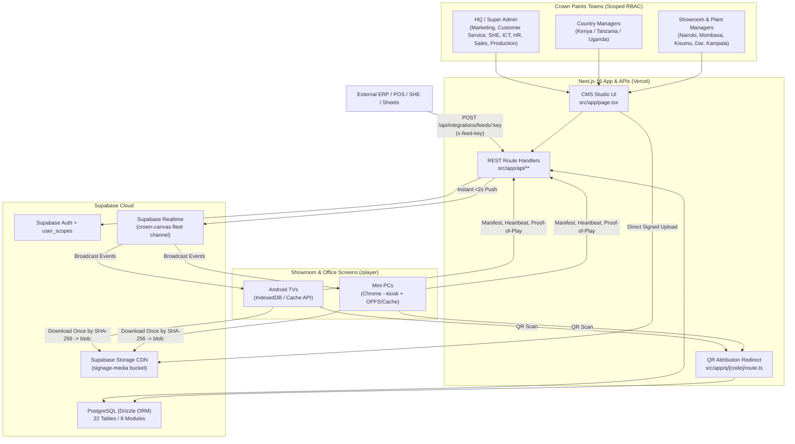

# Crown Canvas — Master Plan & A-to-Z System Architecture

**Crown Canvas** is an enterprise internal digital signage, showroom experience, and corporate communications platform built for **Crown Paints** operations across **Kenya, Tanzania, and Uganda**. It combines a Next.js 16 CMS Studio, Drizzle ORM + Supabase Cloud (PostgreSQL, Storage, Realtime, Auth), and an offline-first PWA player engineered for **Android TVs** and **Mini PCs**.

---

## A–Z Architecture Overview

---

## Complete File-by-File Codebase Map

### 1. Database Layer (`src/db/`)
| File | Purpose |
| :--- | :--- |
| `src/db/index.ts` | Lazy PostgreSQL pooler client (`postgres.js`) tuned for Supabase (`prepare: false`, `max: 5`, `idle_timeout: 20`, `connect_timeout: 15`) with `withDbRetry()` automatic recovery for `57P01` idle disconnects. |
| `src/db/load-env.ts` | Loads `.env.local` / `.env` for CLI tools (`drizzle-kit`, `tsx`). |
| `src/db/seed.ts` | Idempotent seed script creating KE/TZ/UG, sample showrooms, 7 Crown Paints departments, system layouts, starter `east-africa-sales-q4` data feed, Quick Posts, and default playlist. |
| `src/db/schema/locations.ts` | `countries` (`KES`/`TZS`/`UGX` & EAT timezones), `regions`, `branches` (`showroom`, `depot`, `factory`, `hq`). |
| `src/db/schema/departments.ts` | `departments` (`MARKETING`, `CUSTOMER_SERVICE`, `SHE`, `ICT`, `SALES`, `HR`, `PRODUCTION`). |
| `src/db/schema/auth.ts` | `users`, `user_scopes` (Role + Country/Branch/Department scoping), and `audit_logs`. |
| `src/db/schema/screens.ts` | `screen_groups`, `screens`, 6-digit `pairing_codes`, and `screen_commands`. |
| `src/db/schema/assets.ts` | `media_folders` and `media_assets` (with `sha256_checksum` for zero-buffering offline caching). |
| `src/db/schema/studio.ts` | `layouts`, `data_feeds`, `quick_posts`, `playlists`, and `playlist_items`. |
| `src/db/schema/schedules.ts` | `schedules` (dayparting + priority + target scope) and `emergency_overrides`. |
| `src/db/schema/analytics.ts` | `proof_of_play_logs` and `qr_scan_events`. |
| `src/db/schema/index.ts` | Barrel export + Drizzle relations across all 22 tables. |

### 2. Core Libraries (`src/lib/`)
| File | Purpose |
| :--- | :--- |
| `src/lib/supabase/client.ts` | Browser Supabase client for Auth & Realtime subscriptions. |
| `src/lib/supabase/server.ts` | Cookie-aware SSR Supabase client. |
| `src/lib/supabase/admin.ts` | Server-only Service Role client for signed uploads & broadcasts. |
| `src/lib/security.ts` | 6-digit PIN generator, device bearer token generator (`cp_scr_...`), and HMAC-SHA256 hashing. |
| `src/lib/auth-guard.ts` | `getSessionAccess()` and `requireAdminAccess()` RBAC scope enforcement (`NEXT_PUBLIC_REQUIRE_AUTH=true`). |
| `src/lib/audit.ts` | `recordAuditLog()` helper writing immutable admin audit records. |
| `src/lib/realtime.ts` | Broadcasts `manifest_refresh`, `emergency_override`, and `screen_command` over Supabase Realtime. |
| `src/lib/schedule-resolver.ts` | Evaluates active schedules in each country's local EAT timezone (`Africa/Nairobi`, `Africa/Dar_es_Salaam`, `Africa/Kampala`), resolving priority and target specificity. |
| `src/lib/weather.ts` | Fetches & caches (15 min) free Open-Meteo weather for Nairobi, Mombasa, Kisumu, Nakuru, Eldoret, Dar es Salaam, Arusha, Kampala, and Entebbe. |
| `src/lib/player/cache-engine.ts` | Offline-first Cache Storage + IndexedDB asset manager converting downloaded MP4s/images to local `blob:` URLs and evicting stale files. |
| `src/lib/demo-data.ts` | Preview dataset for KE/TZ/UG, 7 departments, and 6-screen Showcase Loop before Supabase keys are added. |

### 3. Frontend Pages & Components (`src/app/` & `src/components/`)
| File | Purpose |
| :--- | :--- |
| `src/app/layout.tsx` | Loads local **Satoshi** font (`public/fonts/satoshi/*.woff`), sets `suppressHydrationWarning`, and mounts `sonner` Toaster. |
| `src/app/page.tsx` & `src/components/dashboard/crown-cms.tsx` | Full enterprise CMS covering Overview, Fleet & Pairing, Showrooms, Departments, Media Library, Playlists & Layouts, Daypart Schedules, Emergency Broadcasts, Data Feeds, Analytics & Audit (CSV export), Team & RBAC, and Crown Studio. |
| `src/app/player/page.tsx` & `src/components/player/player-client.tsx` | Chromeless Android TV & Mini PC player with Wake Lock, 6-tile PIN pairing, Showcase Loop, offline `blob:` playback, Realtime listener, 30s heartbeat, and 45s Proof-of-Play telemetry flush. |
| `src/components/player/multi-zone-frame.tsx` | 3-zone Split Canvas (75% primary media, 25% showroom sidebar with clock/weather/Shade of the Day/QR concierge, bottom `Crown Live` ticker). |
| `src/components/player/quick-post-slide.tsx` | Vector slide templates for Customer Service + Paint Swatches/QR, Marketing Promos (`KES`/`TZS`/`UGX`), HR People & Culture Spotlight, SHE Safety PPE Counter, and ICT Bulletins. |
| `src/components/player/sales-analytics-slide.tsx` | Executive Recharts dashboard slide (`BarChart` Revenue vs. Target + `PieChart` Product Mix donut + 4 KPI cards). |
| `src/app/login/page.tsx` | Enterprise Supabase Auth sign-in screen. |
| `src/app/manifest.ts` | PWA Web App Manifest (`start_url: "/player"`, `display: "standalone"`). |

### 4. API Routes (`src/app/api/**` & `src/app/q/[code]/`)
- **CMS Overview & Auth**: `GET /api/dashboard/overview`, `GET/DELETE /api/auth/session`, `GET/POST /api/users`, `DELETE /api/users/[id]`, `GET /api/health`
- **Locations & Media**: `POST /api/branches`, `POST /api/media/upload-url`, `POST /api/media`, `DELETE /api/media/[id]`
- **Studio & Playlists**: `POST /api/quick-posts`, `DELETE /api/quick-posts/[id]`, `POST /api/playlists`, `PATCH/DELETE /api/playlists/[id]`, `PUT /api/playlists/[id]/items`
- **Scheduling & Broadcasts**: `GET/POST /api/schedules`, `PATCH/DELETE /api/schedules/[id]`, `GET/POST /api/overrides`, `PATCH /api/overrides/[id]`
- **Player & Fleet**: `POST /api/player/pair/request`, `GET /api/player/pair/status`, `POST /api/player/pair/claim`, `GET /api/player/manifest`, `POST /api/player/heartbeat`, `POST /api/player/telemetry`, `PATCH/POST /api/screens/[id]`
- **Integrations & Widgets**: `GET/POST /api/feeds`, `POST /api/integrations/feeds/[key]`, `GET /api/widgets/weather`, `GET /q/[code]`

---

## How Key End-to-End Flows Work (A to Z)

### Flow 1: Zero-Buffering Video Upload & Offline Playback
1. Admin selects an MP4 in **Media Library**. Browser computes its **SHA-256 checksum** via Web Crypto and reads `<video>` duration.
2. CMS calls `POST /api/media/upload-url` → receives a signed Supabase Storage upload URL → uploads the MP4 directly to Supabase Storage (bypassing Vercel's 4.5 MB limit) → saves metadata via `POST /api/media`.
3. Player fetches `GET /api/player/manifest`. `syncAndResolveMediaUrls()` checks local Cache Storage by `(assetId, sha256Checksum)`.
4. New videos download **once**, store locally, and convert to `blob:` URLs. Subsequent loops play from local disk at **0 ms latency**, surviving Wi-Fi outages and keeping Supabase egress minimal.

### Flow 2: Zero-Mouse Android TV / Mini PC Pairing
1. Opening `/player` calls `POST /api/player/pair/request` → displays 6 large glassmorphic digits (e.g. `4 8 2 9 1 0`) and polls `/api/player/pair/status`.
2. Admin claims the PIN in **Fleet & Pairing**, selecting Showroom, Department, Screen Role, and initial Playlist.
3. Server generates `cp_scr_...`, stores its HMAC-SHA256 hash in `screens.device_token_hash`, and hands the raw token once to the TV via `handoffToken`.
4. Player saves the token in `localStorage` and immediately begins cached playback + 30s heartbeats + Realtime listening.

### Flow 3: Live ERP Sales Analytics (`Recharts`) & HR / SHE Slides
1. Admin registers a feed in **Data Feeds (ERP/KPI)** (e.g., `east-africa-sales-q4`) and links it to a `kpi_chart` Quick Post.
2. External ERP/POS or Google Apps Script posts updated JSON (`kpis`, `chartData`, `categoryMix`) to `/api/integrations/feeds/east-africa-sales-q4` with `x-feed-key`.
3. Postgres updates `data_feeds.payload` and Supabase Realtime pushes `manifest_refresh` to all screens, updating Recharts bars and KPIs within seconds while still working offline from the last cached manifest.

### Flow 4: Dayparting & Instant Emergency Broadcasts
- `resolveActiveSchedule()` checks active schedules in the screen's local country timezone (`Africa/Nairobi`, `Africa/Dar_es_Salaam`, `Africa/Kampala`), selecting highest `priority` then specificity (`screen > screen_group > branch > screen_role > country > global`).
- **Emergency / VIP Broadcasts** bypass schedules immediately across the targeted scope and push over `crown-canvas-fleet`.

---

## Operations & Troubleshooting Notes
- **Supabase Pooler `57P01` ("terminating connection due to administrator command")**: Handled in [src/db/index.ts](file:///c:/Users/Admin_Cp/Desktop/Mandela/Projects/Crown%20Canvas/digital-signage/src/db/index.ts) via `idle_timeout: 20`, `max: 5`, `connect_timeout: 15`, and `withDbRetry()` automatic pool reset + retry.
- **Auth Enforcement Toggle**: Keep `NEXT_PUBLIC_REQUIRE_AUTH="false"` during POC; set `"true"` in production so all CMS endpoints require Supabase Auth + `user_scopes`.
- **Kiosk Setup**: See [DEPLOYMENT.md](file:///c:/Users/Admin_Cp/Desktop/Mandela/Projects/Crown%20Canvas/digital-signage/DEPLOYMENT.md) for Chrome `--kiosk` and Android TV setup.
