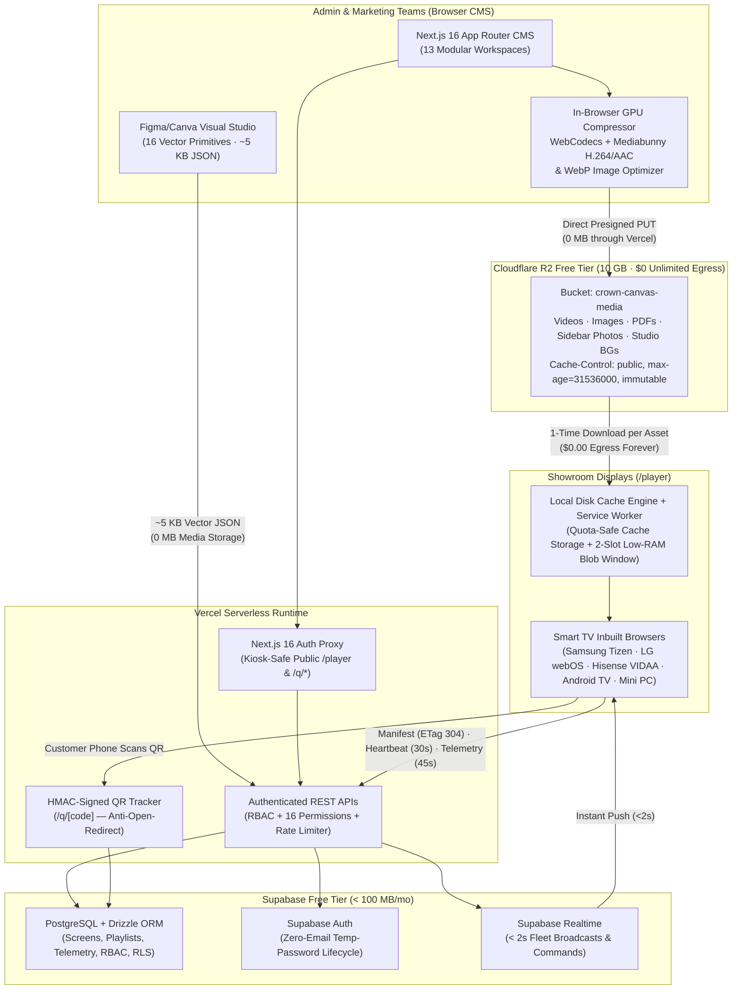

# Crown Canvas — Enterprise Digital Signage Architecture, Engineering Innovations & Operations Guide

> **Document Purpose:** Permanent technical and executive reference explaining how Crown Canvas works end-to-end, every architectural innovation built into the platform, why it operates at **\$0/month cloud infrastructure cost** for 1–50+ showroom screens, and how to deploy, migrate, and operate it safely in production.

---

## 1. Executive Summary & Platform Vision

**Crown Canvas** is a full-stack, offline-first enterprise digital signage CMS and Smart TV player built specifically for multi-location retail showrooms, corporate offices, and industrial facilities. Commercial cloud signage platforms (such as ScreenCloud, Yodeck, or NoviSign) typically charge **\$15–\$25 per screen per month** (\$9,000–\$15,000/year for 50 screens), charge extra for multi-zone layouts and approval workflows, and struggle on unstable retail Wi-Fi or budget Smart TV browsers.

Crown Canvas eliminates recurring per-screen licensing by combining **Next.js 16 (Vercel)**, **Supabase Postgres / Auth / Realtime**, **Cloudflare R2 (`$0` unlimited egress)**, **hardware-accelerated in-browser WebCodecs video compression**, **zero-disk JSON vector studio slides**, and a **self-healing offline Smart TV player**.

---

## 2. System Architecture & Hybrid Zero-Egress Cloud Topology



### Core Technology Stack

| Layer | Technology | Role & Why Chosen |
| :--- | :--- | :--- |
| **Application & API** | **Next.js 16** (App Router, React 19, React Compiler, Turbopack) | Unified full-stack CMS + Player + API routes with zero backend sprawl. |
| **Database & ORM** | **PostgreSQL (Supabase)** + **Drizzle ORM** | Type-safe relational schema with strictly additive migrations, pool-reconnect retry (`withDbRetry`), and Postgres RLS lockdown. |
| **Media CDN & Storage** | **Cloudflare R2** (`@aws-sdk/client-s3`) | **10 GB Free Tier** + **UNLIMITED `$0.00/GB` egress** for all videos, images, PDFs, sidebar products, and Studio backgrounds. |
| **Real-Time Fleet Sync** | **Supabase Realtime Broadcast** | Sub-2-second delivery of emergency takeovers, playlist pushes, remote screenshots, cache clears, and screen reloads. |
| **Client Video Engine** | **Mediabunny + WebCodecs + `@mediabunny/aac-encoder`** | Hardware GPU H.264/AAC MP4 transcoding directly inside the admin's browser—`$0` server compute cost. |
| **PDF Signage Engine** | **Mozilla PDF.js (`pdfjs-dist` + self-hosted worker)** | Toolbar-free, auto-flipping multi-page PDF rendering on TVs with QR fallback for older TV browsers. |
| **UI System** | **Tailwind CSS v4 + Base UI + Recharts + `@dnd-kit`** | Pure white minimalist Vercel/Linear surfaces, drag-and-drop playlists, live ERP charts, and full keyboard accessibility. |

---

## 3. Complete Module-by-Module Breakdown (How Every Feature Works)

### 3.1 Zero-Buffer Offline-First Player (`/player`)
- **6-Digit PIN Pairing:** Unpaired displays request a 6-digit PIN from `/api/player/pair/request`. Refreshing the PIN updates only the PIN card in-place without reloading the page or logo. Once claimed in **Fleet & Pairing**, the player receives a hashed device token persisted in `localStorage`.
- **ETag `304 Not Modified` Manifest Polling:** Every 60 seconds, `/player` checks `/api/player/manifest` with `If-None-Match`. Unchanged playlists return an empty `304` response (~200 bytes), preserving bandwidth and database CPU.
- **2-Slot Low-RAM Double-Buffer Engine (`cache-engine.ts`):** Downloads videos, images, uploaded PDFs, sidebar product photos, and Studio slide images **once** into local `Cache Storage` (`crown-canvas-media-v1`) with in-flight deduplication (preventing double downloads on first boot). Only `[currentItem, nextItem]` `blob:` URLs exist in RAM at any time, revoking old blobs immediately so low-RAM TVs never crash.
- **Offline Power-On Service Worker (`public/sw.js`):** Caches the `/player` shell, Next.js static chunks, `/pdf.worker.min.mjs`, and immutable CDN images/PDFs so displays continue running smoothly even if internet drops completely.
- **Live Proof-of-Playback Snapshots & Eco-Standby:** Heartbeats run every 30s, reporting cache status, currently playing item, and executing remote commands (`identify`, `reload`, `clear_cache`, `screenshot` capturing a live `480×270` JPEG frame). Outside configured location operating hours, displays enter low-power Eco-Standby (automatically bypassed during Emergency Broadcasts).

### 3.2 Universal Smart TV Inbuilt Browser Engine (`tv-browser-compat.ts`)
Built to run natively on **Samsung Tizen, LG webOS, Hisense VIDAA, Sony Bravia, TCL/Android TV, Amazon Fire TV, Philips/Panasonic HbbTV, and Windows/Linux Mini PCs**:
- **Hardware Profile Detection:** Automatically classifies each TV brand and applies tailored local cache ceilings (`192 MB` for inbuilt TV browsers, `512 MB` for Android TV, `2 GB` for Mini PCs), dynamically clamped via `navigator.storage.estimate()` to prevent `QuotaExceededError` tab crashes.
- **Single Hardware Decoder Protection:** Budget and mid-range Smart TVs frequently expose only one hardware H.264 decoder pipeline. On all detected TV browsers (`singleVideoDecoder: true`), the player automatically disables hidden dual-buffer `<video>` preloading while keeping it active on Mini PCs.
- **15-Second Self-Healing Video Stall Watchdog:** Monitors `video.currentTime` every 5 seconds; if playback stalls for 15s it nudges/resumes once, and if still frozen at 25s it advances cleanly so a showroom TV never hangs on one frame.
- **CORS-Safe Video Retry & Legacy Polyfills:** Uses `AbortController` timeouts instead of Chrome-103+ `AbortSignal.timeout`, vendor-prefixed Fullscreen APIs (`webkitRequestFullscreen`), private-mode-safe storage wrappers, idle cursor auto-hide (`4s`), Wake Lock re-acquisition on `visibilitychange`, cross-brand TV remote shortcuts (`OK` for Fullscreen + audio unlock, `↑/Info` for 8s HUD reveal), and a 10-second auto-reloading `PlayerErrorBoundary`.

### 3.3 Hardware-Accelerated In-Browser GPU Video Compressor (`video-compressor.ts`)
- **Zero-Server Transcoding:** Large agency video exports (300 MB–1.7 GB MOV/MP4/WebM) are streamed directly from the admin's disk via `BlobSource` and transcoded on the admin's GPU using WebCodecs (`H.264 AVC` + `AAC` stereo + MP4 Fast Start).
- **Duration-Aware Bitrate Planner:** Automatically picks optimal 1080p or 720p dimensions (preserving portrait `9:16` totems with even H.264 dimensions) and crisp signage bitrates (`1.3–2.0 Mbps` in `auto_fit`, targeting `~16–24 MB` for 2-minute clips) so 2–3× more videos fit comfortably inside every Smart TV's local cache.
- **SHA-256 Deduplication:** Before uploading any file, the browser hashes the file; if an identical active file already exists in the library, the server reuses it with **0 extra bytes** uploaded.

### 3.4 Zero-Disk Visual Crown Studio & 16 Agency-Grade Templates (`canvas-editor.tsx` & `canvas-renderer.tsx`)
- **Canva/Figma-Class Browser Editor:** Drag-to-move, 8-handle resize, exact integer rotation (`-360°..360°`) + drag-rotate handle, horizontal/vertical flip, smart center/sibling snap guides, inline double-click text editing, zoom (`Fit/50%–125%`), 5% TV overscan safe-zone grid, undo/redo, layer ordering, and PNG export.
- **16 Vector & Live Infographic Primitives:** Headings, pills, shapes, 36 vector icons, Crown paint swatch cards, multi-currency price tags, Recharts bar/donut/progress charts, spec comparison tables, numbered step callouts, styled lists, packshot images, and auto-tracked QR codes.
- **Zero-Disk Delivery:** Every Studio design saves as a **~5 KB JSON document** rather than a 30 MB rendered video and renders pixel-identically on 720p, 1080p, and 4K displays—plus admins can upload custom Studio Canvas Backgrounds (`studio_backgrounds`) directly to Cloudflare R2.

### 3.5 Per-Playlist Reusable Sidebar Profiles & Responsive TV Display (`sidebar-designer-panel.tsx` & `multi-zone-frame.tsx`)
- **Per-Playlist Sidebars:** Admins create reusable **Sidebar Profiles** (choosing from 4 visual themes: *Pure White Minimal*, *Warm Editorial*, *Executive Navy Dark*, *Industrial Slate Dark*, custom tracked QR code, clock/weather toggles, rotation interval, and curated products) and attach different sidebars to different playlists—or click **Auto-Create Sidebar** on any playlist to generate and link a dedicated sidebar in 1 click.
- **CMS Product Showcase Automation:** Add, edit, reorder, hide, or delete showcase items simply by attaching a photo (auto-compressed to WebP), setting a **Badge Header**, **Product Name**, and **Description**.
- **Natural Non-Squeezed TV Proportions:** Fluid clamped sidebar width (`w-[clamp(260px,24vw,430px)]`) and `object-contain` product framing preserve natural aspect ratios across 32" 720p, 43"–65" 1080p/4K, ultrawide, and portrait `9:16` vertical totems.

### 3.6 Multi-Page Toolbar-Free PDF Slideshow (`pdf-signage-viewer.tsx`)
- Upload `.pdf` brochures directly in **Media Library** (stored on Cloudflare R2 and locally cached on TVs).
- Renders high-DPI pages edge-to-edge without any browser toolbar, auto-flipping pages evenly across the slide duration. On older Smart TV browsers that lack both PDF.js worker support and inline PDF plugins, gracefully renders a branded scannable QR preview card.

### 3.7 Daypart Scheduling, Maker-Checker Governance & 3-Mode Emergency Broadcasts
- **Priority Daypart Resolver:** Evaluates active time windows and days of week in local timezone, resolving ties by specificity (`screen > branch > country > global`).
- **3-Mode Instant Emergency Broadcasts (`< 2s`):** Interrupt targeted screens, groups, locations, or the entire fleet immediately with a **Custom Full-Screen Alert**, a **Media Clip Takeover**, or a **Full Emergency Playlist Takeover**.
- **Maker-Checker Approval Queue:** Senior roles auto-approve; branch/content editors submit to an approval queue before content can enter any TV's manifest.

### 3.8 Universal Automated QR Scan Tracking & Executive Analytics (`analytics-tab.tsx` & `/q/[code]`)
- **100% Automatic Attribution:** Every QR code—whether in a Playlist Sidebar, a Crown Studio Canvas slide, or a Quick Post—is automatically signed server-side and routed through `/q/[code]`, logging `sourceType` (`sidebar | studio_slide | quick_post`), `campaignLabel`, `screenId`, `branchId`, `targetUrl`, and mobile OS (`iOS / Android / Desktop`) while filtering out crawlers/bots.
- **Analytics & ROI Reporting:** Provides Playback Impressions trends, **QR Scans Attribution Report** (KPIs, Scans by Location bar chart, Top Campaigns, searchable/paginated log, CSV export), printable **Executive Fleet SLA & ROI Report**, paginated Administrative Audit Trail, and 90-day log pruning.

### 3.9 360° Zero-Email Authentication, Custom RBAC & Password Lifecycle
- **Zero SMTP / Email Dependency:** Admins create users with a one-time readable temporary password (`generateTemporaryPassword()`). Users are forced to change it on first login (`/change-password`, enforced server-side via HTTP `428 PASSWORD_CHANGE_REQUIRED`).
- **Full Password Governance:** Configurable password expiry policy (`auth_settings`, e.g., 90 days or disabled), 7-day expiry warning banner, self-service password updates (current-password verified), and 1-click Admin temp-password resets that immediately revoke active sessions.
- **16-Permission Custom RBAC:** 6 auto-seeded system roles plus unlimited custom roles combining granular permissions with geographic/departmental scopes (Region, Location, Department).

### 3.10 6-Layer Cloud Security Hardening
1. **Strict Webhook Auth & Constant-Time Secrets:** Feed push webhooks enforce RBAC (`feeds:manage`) for CMS tests and `crypto.timingSafeEqual` for external ERP API keys.
2. **HMAC-SHA256 Anti-Open-Redirect QR Links:** `/q/[code]` verifies cryptographic signatures before redirecting, preventing phishing abuse.
3. **SSRF Protection on Remote Feed Pulls:** `assertSafeExternalUrl()` blocks localhost, RFC1918 private IPs, cloud metadata (`169.254.169.254`), DNS rebinding, redirects, and > 2 MB payloads.
4. **HTTP Security Headers (`next.config.ts`):** Strict HSTS, `X-Content-Type-Options: nosniff`, `X-Frame-Options: SAMEORIGIN`, `Referrer-Policy`, `Permissions-Policy`, and Content Security Policy.
5. **Sliding-Window Rate Limiting (`rate-limit.ts`):** Protects pairing PIN requests, password changes, feed webhooks, and QR redirect endpoints.
6. **Supabase Postgres RLS Lockdown (`scripts/enable-rls-lockdown.sql`):** Blocks direct anonymous PostgREST API access across all `public` tables while keeping server Drizzle queries untouched.

---

## 4. Catalogue of Key Engineering Innovations

| # | Innovation | Problem Solved | Impact |
| :--- | :--- | :--- | :--- |
| 1 | **Client-Side WebCodecs GPU Video Compressor** | 300 MB–1.7 GB agency videos exceed cloud limits and choke TV Wi-Fi; server FFmpeg costs money. | Compresses videos 85–95% right on the admin's GPU at **\$0 server cost**, fitting 2–3× more videos in TV cache. |
| 2 | **Hybrid Supabase + Cloudflare R2 `$0`-Egress Split** | Supabase Free Tier caps storage at 1 GB and CDN egress at 5 GB/mo. | Moves all heavy media to R2 (**10 GB free, unlimited `$0` egress**), keeping Supabase under 100 MB/mo forever. |
| 3 | **Zero-Disk JSON Vector Studio + Live ERP Infographics** | Exporting promotional slides as PNGs/MP4s wastes storage and requires re-rendering on edits. | ~5 KB JSON slides render crisply at any TV resolution (720p–4K) with **0 MB media storage**. |
| 4 | **2-Slot Low-RAM Blob Window + Single-Decoder TV Mode** | Loading full playlists into RAM or dual `<video>` tags crashes or stutters budget Smart TVs. | Keeps memory flat and protects single-pipeline TV hardware decoders across Tizen, webOS, VIDAA & Android TV. |
| 5 | **In-Flight Download Deduplication + Zero-Bandwidth CMS Cards** | Players double-downloaded videos on boot; CMS admins burned GBs preloading `<video>` grid cards. | Cuts player initial load by 50% and drops CMS Media Library video egress by **99%**. |
| 6 | **15-Second Video Stall Watchdog + 10s Error Boundary** | Unattended showroom TVs on flaky Wi-Fi stall mid-video or freeze on white error screens. | Self-heals stalled videos and runtime errors automatically with zero staff intervention. |
| 7 | **Zero-Email Enterprise Auth & Temp-Password Lifecycle** | Organizations without transactional SMTP still need secure onboarding, resets & password rotation. | Full enterprise password compliance (forced first-login reset, expiry policy, global sign-out) with zero email infra. |
| 8 | **HMAC-Signed Universal QR Attribution** | Open `/q/[code]?to=...` redirectors get abused by phishers; manual QR links lose analytics. | Every sidebar & slide QR is automatically tracked and cryptographically tamper-proof. |
| 9 | **Per-Playlist Reusable Sidebar Profiles** | Different departments/showrooms need different product showcases, themes & QR destinations. | 1-click Auto-Create Sidebar per playlist with fluid clamped non-squeezed TV typography & imagery. |
| 10 | **1-Command R2 CORS & Zero-Downtime Migration Scripts** | Manually configuring S3 CORS and migrating live database URLs is error-prone. | Idempotent CLI scripts verify every migrated R2 object via `HEAD` before rewriting Postgres URLs. |

---

## 5. Cost & Capacity Economics (50-Screen Showroom Fleet)

| Resource | Commercial SaaS (e.g., ScreenCloud / Yodeck) | Crown Canvas (Hybrid Free Architecture) |
| :--- | :--- | :--- |
| **Per-Screen License (50 TVs)** | \$15–\$25 / screen / mo (**\$9,000–\$15,000 / yr**) | **\$0 / yr** |
| **Media Storage & Egress (Videos, Images, PDFs)** | Bundled in paid tier | **Cloudflare R2 Free Tier:** 10 GB storage + **Unlimited `$0` Egress** |
| **Database, Auth & Realtime** | Bundled in paid tier | **Supabase Free Tier:** 500 MB DB + 5 GB egress (~50–100 MB/mo actual usage) |
| **Web App & API Hosting** | Bundled in paid tier | **Vercel Hobby/Pro:** 0 MB media proxied through serverless functions |
| **Video Transcoding** | Paid cloud workers | **\$0** (runs on admin's browser GPU via WebCodecs) |
| **Estimated 3-Year Total Cost (50 TVs)** | **\$27,000 – \$45,000** | **\$0** *(or ~\$20/mo Vercel Pro if team collaboration seats desired)* |

---

## 6. Production Operations & Migration Runbook

### Required Environment Variables (`.env.local` & Vercel Project Settings)
```env
DATABASE_URL="postgresql://..."
DIRECT_URL="postgresql://..."
NEXT_PUBLIC_SUPABASE_URL="https://<ref>.supabase.co"
NEXT_PUBLIC_SUPABASE_ANON_KEY="..."
SUPABASE_SERVICE_ROLE_KEY="..."
SIGNAGE_TOKEN_SECRET="..."
NEXT_PUBLIC_REQUIRE_AUTH="true"

# Cloudflare R2 ($0 Unlimited Egress Media Storage)
STORAGE_PROVIDER="r2"
R2_ACCOUNT_ID="<cloudflare-account-id>"
S3_API="https://<cloudflare-account-id>.r2.cloudflarestorage.com"
R2_ACCESS_KEY_ID="<r2-access-key-id>"
R2_SECRET_ACCESS_KEY="<r2-secret-access-key>"
R2_BUCKET_NAME="crown-canvas-media"
R2_PUBLIC_BASE_URL="https://pub-xxxx.r2.dev"
```

### One-Time Cloudflare R2 Setup & Migration Commands
Run inside `digital-signage/`:
```powershell
# 1. Configure R2 CORS automatically for direct CMS uploads & TV player playback
npm run storage:setup-r2-cors

# 2. Preview all Supabase Storage files that will be migrated to R2
npm run storage:migrate-r2 -- --dry-run

# 3. Copy all existing videos, images, PDFs, sidebar products & Studio BGs to R2 and update DB URLs
npm run storage:migrate-r2

# 4. After verifying playback on /player loads from pub-*.r2.dev, optionally purge old Supabase copies
npm run storage:migrate-r2 -- --purge-supabase
```

### Related Operational Guides
- **Smart TV Inbuilt Browser Setup (Samsung, LG, Hisense, Android TV):** `docs/SMART-TV-BROWSER-SETUP.md`
- **Standalone Android TV Kiosk Deployment:** `docs/ANDROID-TV-DEPLOYMENT.md`
- **Windows Mini-PC Auto-Boot Watchdog:** `scripts/install-windows-kiosk.ps1`
- **Supabase Postgres RLS Lockdown SQL:** `scripts/enable-rls-lockdown.sql`
